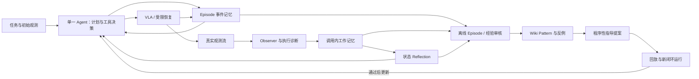

# 第三章写作依据与实现核对

本文是 [第三章正文](method_zh.md) 的作者工作说明，不属于拟投稿正文。核对日期：2026-09-08。正文描述当前代码支持的完整配置，不把候选实验、设计原则或预期收益写成既有结论。本次只撰写文稿和核对实现，未运行新的机器人实验。

## 1. 方法章节的组织参考

### 1.1 ICRA 2026 获奖与入围论文的写作参考

本轮将用户输入的“icra 0206”按 ICRA 2026 理解，阅读以下论文的引言、问题定义、方法和实验组织。奖项与论文内容分别核对：会议的 [Award Finalists 页面](https://2026.ieee-icra.org/awards/) 列出的是入围名单，获奖身份另由 IEEE、作者机构或项目页确认。表中记录实际阅读的公开版本，不据此声称它们与会议最终排版完全相同。

| 论文与奖项依据 | 原文组织与技术主线 | 对本稿的写作启发 |
| --- | --- | --- |
| **SymSkill**；Best Conference Paper，由 [IEEE RAS 报道](https://www.ieee-ras.org/yifei-simon-shao-on-symskill-and-long-horizon-robot-manipulation/) 确认。 | 第 V 节依次说明分段与参考系、谓词、算子、技能和在线执行。相对位姿连接离线表示学习与在线技能组合、恢复；其问题设置明确假定可跟踪对象类型和 6D 位姿。[原文 v2](https://arxiv.org/html/2510.01661v2) | 学习“同一表示贯穿学习与执行”的论述方式。我们应说明执行记录如何连接当前判断与后续经验；保留自身部分可观测设置，不借用它的符号状态或技能学习能力。 |
| **OmniRetarget**；项目页标注 Best Conference Paper 及 Manipulation and Locomotion 奖。[奖项依据](https://omniretarget.github.io/) | 第 III 节集中描述交互保持的重定向，内部展开带硬约束的交互网格与数据增强；第 IV 节再说明下游策略学习。核心关系表示、约束和复用方式先于整个训练流程展开。[原文 v3](https://arxiv.org/html/2509.26633v3) | 先讲清我们保留什么过程信息、如何组织、怎样被决策消费，再写经验如何更新。VLA 和工具的篇幅按它们对该信息链的作用分配。 |
| **LASER**；Best Student Paper，由 [斯图加特大学公告](https://www.icd.uni-stuttgart.de/news/IEEE-ICRA-2026-Best-Student-Paper-Award/) 确认。 | 第 IV 节定义调度约束和 level，第 V 节给出适配不同任务结构的算法，第 VI 节解释 level 如何用于实际执行。规划与执行由 level/barrier 机制连接。[原文 v1](https://arxiv.org/html/2603.20577v1) | 每项约束都应交代它限制了哪一步决策。我们的预算结束、计划推进与效果判断需要明确区分；控制器细节可放补充材料。 |
| **IMR-LLM**；Automation 奖入围，依据 [会议名单](https://2026.ieee-icra.org/awards/)，本次不标为获奖。 | 第 III 节定义问题与图表示，第 IV 节用任务规划、程序生成、执行三节展开。LLM 构造任务信息，图求解与过程树分别处理调度和程序组织。[原文 v1](https://arxiv.org/html/2603.02669v1) | 明确模型解释、确定性记录和运行时约束的职责。三小节可以承载完整框架，但节数本身不代表论文质量。 |

以下是结合这些原文与本仓库作出的写作判断，属于本稿的组织选择：

- **先明确需要传递的信息。** 本文的问题是高层决策间隔内的执行变化，以及这些变化与任务历史的联系；Observer、Working Memory 和 Episode Memory 分别承担获取、组合与保留的职责。
- **以表示的使用方式连接模块。** 3.1 定义证据如何影响判断和工具选择；3.2 解释这些证据从哪里来、保留什么；3.3 说明如何审核记录中的判断与后果，更新下一次运行的指导。
- **公式表达具体机制。** 保留决策接口、反思接口、事件选择、工作记忆、经验单元和候选筛选规则。固定恢复动作的几何参数不占用与核心证据机制相同的正文层级。
- **收益由对应实验支撑。** “提供过程信息”可由实现说明，“减少误判”“改善长程成功率”“有益跨 episode 迁移”需要分别验证。当前稿只陈述机制及适用边界。

SymSkill 的方法本身有五个小节，因此不能归纳出“Best Paper 都只有三节”的规则。我们保留三节，是因为计划、VLA 与恢复共同构成执行框架，而过程证据和经验更新需要单独解释。获奖论文提供写作参考；本工作的创新性仍需与 VoLo、HiMe、WikiSkill、ASPIRE 等直接相关工作比较。

### 1.2 近期直接相关工作的组织参考

以下参考用户提供的近期工作，按“整体框架—核心信息机制—经验更新”确定论述层级。VoLo 项目页标注 CoRL 2026，HiMe 项目页标注 ICML 2026；其他条目按本次核对的预印本版本引用。

| 论文 | 方法如何组织 | 本章采用的写法 |
| --- | --- | --- |
| **Harness VLA** | 第 2 节以问题与执行循环、Agent 架构和统一原语接口组织框架；记忆构建与具体原语细节在附录展开。 | 将计划、VLA 调用及恢复视为统一 Agent 框架中的执行机制，正文保留接口和关键约束。[方法正文](https://arxiv.org/html/2607.08448v1) |
| **VoLo** | 第 4.1 节定义物理编排要求，第 4.2 节将初始执行、监控路由和恢复放在同一系统节中。 | 将计划、状态判断与恢复合并在 3.1，说明其如何共同闭环。我们没有其由语义监控触发的中途 VLA 中断机制。[项目页](https://chicychen.github.io/VoLo/)、[方法正文](https://arxiv.org/html/2606.07723v1) |
| **HiMe** | 按 Executor、Sentry、Planner 的时间尺度说明职责，再解释跨模态记忆及主动管理。 | 在 3.2 围绕“执行过程如何进入低频决策”组织 Observer、Working Memory 和 Episode Memory。我们不将 Sentry 语义完成触发或语义 CRUD 写成已有实现。[方法说明](https://happywaterxp.github.io/HiMe/) |
| **WikiSkill** | 第 3.1 节说明知识层次，第 3.2 节在同一个更新流程下组织推理、维护、提案、验证与回滚。 | 将经验形成、Pattern、程序性指导及 Gate 合并为 3.3；验证服务于经验能否进入下一次执行。[方法正文](https://arxiv.org/html/2608.27454v1) |
| **BATON** | 第 3 节先给出基础与问题，再以子任务探索和 transition-aware memory 两项机制展开。 | 区分已有执行底座与需要详细说明的信息机制；不把任务分解、工具调用等所有环节并列为新贡献。[方法正文](https://arxiv.org/html/2608.16889v1) |
| **ASPIRE** | 方法将执行反馈、程序修复与验证、持久技能积累及演化探索连接起来，并给出整体流程算法。 | 保留一个贯穿在线与离线的算法，解释执行证据如何服务经验维护；“失败总结后生成 Skill”不单独作为创新。[方法正文](https://arxiv.org/html/2607.00272v1) |

WikiSkill 是跨 episode 部分的思想来源，应在正文或相关工作中保留引用。它已包含持久 Wiki、原始轨迹、程序性 Skill、提案、验证和回滚，不能将该链路独立宣称为本工作的首创。[WikiSkill 方法](https://arxiv.org/html/2608.27454v1)

## 2. 本章的论述分工

- **3.1 长程具身 Agent 框架**：定义任务和模型接口，将计划、VLA 执行、Reflection 与恢复写成一个完整的在线控制流程。
- **3.2 执行过程观察与任务内记忆**：展开低频决策所需的过程信息，包括 Observer 窗口、确定性事件、调用内工作记忆和跨调用历史。
- **3.3 跨 episode 经验形成与管理**：说明证据与解释如何被审核、积累为 Pattern，并在回放和新执行验证后形成生效指导。

原 3.2 的计划和动作执行、原 3.4 的状态判断和恢复已经并入框架；原 3.4 的 episode 历史归入任务内记忆；原 3.5 与 3.6 合并为同一经验管理流程。正文只保留三个二级小节，内部用段首短语标示机制。计划连续性改用文字表述，固定回撤几何公式移入下方实现说明，编号公式从八组收拢为六组。

正文开头直接概述方法，以“过程证据—在线判断与干预—经审核的行为更新”连接三节；问题动机留待引言展开。正文按机制、表示与决策准则组织，执行门禁、Observer 预算和候选验证条件保留，字段清单与实现检查放在本说明中。这一论述同时覆盖 Agent 设计和经验管理，Skill 是指导的载体。

正文不写实验收益、不宣布组件首创。模型型号、服务部署、相机分辨率、任务分组、完整提示词、控制器全部容差与回放案例构造细则，应进入实验设置或补充材料。

## 3. 正文与代码的对应关系

| 正文内容 | 实现来源 | 必须保留的解释边界 |
| --- | --- | --- |
| 单一 Agent、固定工具集合、Skill 注入 | [runtime.py](../../agent/roboagent/runtime.py)、[loader.py](../../agent/roboagent/skills/loader.py) | Planner 和 Tool Calling Agent 是一个主循环中的职责；Reflection 与决策使用同一模型。 |
| 计划不变量、推进和回退 | [runtime.py](../../agent/roboagent/runtime.py) 中 `_create_task_plan`、`_advance_task_plan`、`_repair_task_plan` | 顺序推进、连续状态、步骤自己的 VLA 执行前置要求；没有依赖图推理或任意动态计划编辑。 |
| VLA 的 B-chunk 执行 | 同文件 `_execute_vla`、`_execute_vla_chunks` | B 默认 24，chunk 中动作数另行配置；不能把一个 chunk 写成一个控制步。 |
| checkpoint 原语先验 | [robomemarena.py](../../agent/roboagent/prompts/robomemarena.py) | 来自任务与 checkpoint 的指令参考，需要在实验设置披露，并统一基线条件。 |
| 中途一次、尾部一次观察 | [visual_observer.py](../../agent/roboagent/observer/visual_observer.py) | 单并发、非重叠窗口、返回前等待尾部；不是每个控制步都做 VLM 推理。 |
| 夹爪事件采样 | [sampler.py](../../agent/roboagent/observer/sampler.py)、[execution_diagnostics.py](../../agent/roboagent/observer/execution_diagnostics.py) | 累计 qpos 变化最大帧；窗口选择最后一个检测事件的帧，预算不足时不加入；事件不证明持有目标。 |
| 工作记忆及其图像 | [working_memory.py](../../agent/roboagent/memory/working_memory.py)、[execute_vla.py](../../agent/roboagent/tools/execute_vla.py) | 式 (4) 是完整工具证据的概念表示；结束图像来自返回 observation，并非 `VlaWorkingMemory` 单独持有所有字段。中间关键帧不直接送给 Planner。 |
| 变化高亮 | [visual_evidence.py](../../agent/roboagent/visual_evidence.py) | OpenCV 绝对差、灰度阈值 25、5×5 形态学核；无目标检测、语义 ROI 或成功验证。不可用时退回首尾原图。 |
| 状态 Reflection | [state_reflection.md](../../agent/roboagent/prompts/state_reflection.md)、runtime `_prepare_next_turn` | 自然语言输出，没有已实现的结构化 belief、自动置信度或自动步骤标签更新。 |
| 历史整理 | [episode_memory.py](../../agent/roboagent/memory/episode_memory.py) | 以账本替代旧工具结果；保留最近工具、最近 VLA、最近有图像的工具结果。Assistant 历史仍可能包含判断和动作理由；不是固定 token 长度记忆。 |
| 受限恢复 | [ee_pose.py](../../agent/roboagent/utils/ee_pose.py)、runtime 的 recovery 方法、[client adapter](../../benchmark/robomemarena/client/adapter.py) | Home 目标在 reset/warmup 后记录；夹爪工具零增量不保证实际末端绝对不动。工作区保护不是完整碰撞保证。 |
| 评分通道分离 | [adapter.py](../../benchmark/robomemarena/client/adapter.py)、[evaluation.py](../../benchmark/robomemarena/server/evaluation.py) | 终态信号可用于结束任务，隐藏阶段和 CSR 等中间评分不进入在线 Agent。 |
| 事件形成与来源 | [compiler.py](../../agent/roboagent/evolution/compiler.py) | 自动事件和 reviewed events 分开；官方事件关联是时间归属，不是因果识别。视觉 artifact 字段可能为空，审核时经日志引用补充。 |
| Pattern 支持与 Skill 修改 | [workspace.py](../../agent/roboagent/evolution/workspace.py) | 当前 scope 是元数据与文内条件；单章节 diff 是语法约束，不保证语义上严格只有一个行为改变。 |
| 回放 | [schema.py](../../agent/roboagent/evolution/schema.py)、[replay.py](../../agent/roboagent/evolution/replay.py) | 文本下一工具选择；不执行原始视觉识别、机器人动作或完整 runtime guard。 |
| Gate、晋升和历史 | [gate.py](../../agent/roboagent/evolution/gate.py) | 字典序聚合分数、禁止成功任务退化、至少两个不同 Candidate 运行；Final Evaluation 当前是可选的激活后审核。 |

## 4. 当前边界与需要作者决定的事项

### 4.1 两种“频率”不能混用

本文按调用边界描述高层决策和观察预算，没有声称固定的高低频率比。一次 VLA 调用包含多次低层推理和执行，Observer 的中途计算可与执行重叠，尾部会等待。是否减少总延迟、是否优于提高 Planner 频率，需要单独测量。更长调用也可能遗漏窗口未采样的短暂事件，不能宣称完整捕获全部中间过程。

### 4.2 Reflection 不是信息隔离证明

代码过滤工具结果中的若干计划与预算字段，但仍保留其他 transcript 文本；不能声称 Reflection 完全看不到历史计划信息。Skill 直接注入正常决策 system prompt，不直接注入独立 Reflection system prompt；它仍可能通过此前动作和文本间接影响后续反思。

### 4.3 三个时间跨度不等于三层完备语义记忆

当前 Working Memory 是调用内证据，Episode Memory 是工具事件账本，跨 episode Skill 是一份文档。尚无自动更新的 `opened_once`、计数器、对象去向结构化账本，亦无 Global/Family/Task 三路自动检索。候选 v017–v019 的语言指导不应写成已经验证的独立状态模块。

### 4.4 进度同步规则与计划门禁的冲突

`advance_task_plan` 要求当前步骤先执行自己的 VLA；某些候选却要求新步骤已在物理上满足时直接推进，或修复后不重复已确认倾倒。正文保留实际门禁，没有加入未实现的“仅靠历史证据跳过动作”能力。若将这种同步作为核心贡献，需要先定义并实现相应转换，再评测；只通过文本回放不足以证明在线合法。

### 4.5 规范与代码不完全一致

V3 原则描述按作用域区分的成熟度；当前校验器主要按唯一 Episode 数检查 `probable`，按不同 task 数检查 `verified`，尚未机械验证各作用域的全部独立泛化要求。正文仅使用实际支持的正式候选证据阈值，没有把 `verified` 当成跨任务泛化已被证明。

原则文件还提出两个 Candidate 分别优于 Parent；当前 Gate 检查的是聚合字典序分数，并额外禁止 Parent 成功变失败。正文按代码写聚合规则。不同运行目录是现有独立性检查的一部分，不构成统计独立证明。一个 Parent 被复用为多个配对锚点时，应公开报告实际独立样本数。

### 4.6 离线语义维护与监督来源

自动编译器负责确定性事件提取，复杂事件审核、Pattern 归纳和提案维护仍有人工或外部维护 Agent 参与。正文对此作了明确披露。正式实验还需列明维护模型、提示词、人工筛选或标签修正工作量，以及各方法获得的相同数据与预算。

隐含阶段信息用于离线审核，因此不能宣称整个方法不使用特权监督。官方阶段通过也不自动确认某个恢复工具的必要性或物理因果作用。基准存在本地评分修复，最终对照应采用同一 evaluator revision，并在实验章节说明补丁口径。

## 5. 图示与补充材料建议

正文所述配对验证在实现中匹配任务、seed、模型、runtime/evaluator revision 和执行参数，核验实际加载的 Skill 内容哈希，并排除候选经验归纳依赖的来源运行。Episode 保存原始轨迹引用与哈希，候选保存来源 Pattern 哈希。当前约束分离的是来源运行与验证运行，不要求它们属于不同任务或 seed；不得将其表述为已完成跨任务留出测试。

正文的局部指导修改在实现中通过只允许修改 Skill 文档的一个二级章节限制编辑范围，该约束不证明语义上仅有一个行为变化。历史决策回放使用相同 Planner 与工具 schema，比对工具名和必要参数，忽略自由文本理由；不执行视觉识别、物理动作及完整运行时门禁。配对闭环通过聚合分数判定增益，且不允许原成功任务退化。激活后独立最终评测是可选流程，不能写成所有候选均已通过该评测。

工作记忆使用 sequence 与事件标识对齐观测，保留关键帧元数据、chunk 数和停止原因；文本采用精确去重并保留重复项的最后位置。Episode Memory 保留最近工具结果、最近 VLA 工作记忆和最近带图像的物理结果。夹爪事件检测默认阈值为 $\delta_g=0.01$，观察器在图像预算内选取转换帧。RoboMemArena 的 Planner 还获得任务匹配的 checkpoint 原语指令参考；该任务先验应在实验设置中披露。

正文省略的实现参数包括：VLA 默认单次预算 $B=24$ 个 chunk；Reflection 使用 2–4 句自然语言；局部 OSC 默认平移和旋转上限分别为 0.08 m 和 30°。反思上下文过滤工具文本中的 chunk 预算、停止原因及计划进度，恢复结果保留实际执行状态，以区分完整收敛与部分位移。对应代码见上方映射。

固定回撤的几何实现为 $p^*=p_0-dR_{wc}e_z$，其中 $d=0.05\,\mathrm m$，$R_{wc}$ 将腕部相机方向变换到世界坐标系，$e_z=(0,0,1)^\top$；执行保持调用前末端朝向和夹爪命令。该公式说明一个既有恢复原语的参数化方式，正文只保留动作语义，将其作为 3.1 框架内的工具细节。

正文图应突出同一证据链连接在线与离线两个循环：

图注需补充：Observer 不直接控制 VLA；恢复工具返回首尾证据，但不启动新的 VLA 工作记忆；环境已终态时不再生成状态反思。图中的箭头是信息依赖，不表示每个组件在固定频率下持续运行。

建议补充材料提供：完整 system/observer/reflection 提示词、全部工具 schema、采样预算和控制容差、Experience/Pattern 示例、回放允许动作的标注协议、候选提案及全部运行记录。独立最终测试与用于提案选择的运行要分开报告。

## 6. 与方法主张对应的实验问题（待执行）

以下用于后续实验章节规划，不表示已完成评测或现有组件已有独立收益。

| 方法要回答的问题 | 需要的对照 | 应报告的证据 |
| --- | --- | --- |
| 调用内过程信息是否改善状态判断？ | 完整系统、仅首尾图像、移除 Observer 或移除确定性事件；另加入提高 Planner 调用频率的预算对照。 | 有审核标签的步骤状态判断、错误推进与遗漏恢复的比例，以及成功率、模型调用量和实际延迟。 |
| 跨调用历史是否支持长程进度维护？ | 同一在线系统中保留或移除 Episode Memory，固定可见信息和交互预算。 | 不必要的重复动作、已失效前置条件的发现与恢复、分不同任务长度的成功率。 |
| 审核后的经验是否改善后续执行？ | 固定在线框架，比较无更新、直接从轨迹总结指导、经过资格审核与验证的指导；统一来源数据及维护预算。 | 来源之外的新运行结果、原成功任务退化数、留出初始状态或任务表现；人工与模型维护成本。 |

当前最值得检验的研究假设是：执行过程证据不仅改善当次决策，也为后续经验形成提供更可审核的依据。要支持后一部分，应在相同来源轨迹上控制可用证据，而不能只比较“有整套系统”和“没有整套系统”的最终成功率。还应固定实际工具与计划门禁，避免候选文本回放通过却在线不可执行的问题。
